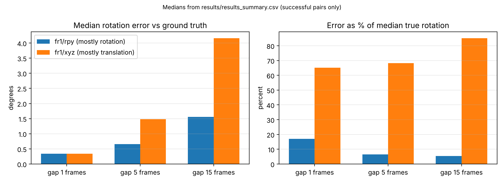

# Rotation vs. Translation in COLMAP on TUM RGB-D

A small, reproducible study of how camera motion type (mostly rotation vs. mostly translation) affects (1) a rotation-only homography model and (2) COLMAP reconstruction, evaluated against motion-capture ground truth on two public sequences. Motivation: broadcast sports cameras are mostly pan-tilt-zoom units on fixed mounts, so their motion is close to pure rotation with little parallax, which is hard for SLAM/SfM-style pipelines.

**Status:** parts 1 and 2 are complete. The 3D Gaussian Splatting evaluation and a COLMAP-settings ablation are **not complete** (see [Pending work](#pending-work)).

## Data

Public [TUM RGB-D](https://cvg.cit.tum.de/data/datasets/rgbd-dataset) sequences, not my own capture:
- `freiburg1_rpy`: camera rotated at a roughly fixed position.
- `freiburg1_xyz`: camera translated along the axes, orientation mostly fixed.

Neither is pure. Ground-truth statistics from the notebook:

| | fr1/rpy | fr1/xyz |
|---|---|---|
| Frames with ground truth | 720 | 796 |
| Position extent (x, y, z), m | 0.15, 0.18, 0.19 | 0.46, 0.70, 0.40 |
| Max rotation from start | 112.7° | 22.2° |

The data is not included in this repo. Please see TUM's page for its license and download terms.

## Method

1. Undistort frames with the published Freiburg 1 RGB intrinsics.
2. **Rotation-only test:** for frame pairs at gaps of 1, 5 and 15 frames, estimate one homography (SIFT + RANSAC), convert it to a rotation with `R = K⁻¹HK`, and report its angular error against the ground-truth relative rotation. The notebook first checks whether the ground-truth quaternions behave as camera-to-world or world-to-camera by testing against the images.
3. **COLMAP:** run on 200 evenly spaced frames per sequence (sequential matching via `ns-process-data images`); report registered frames, 3D points, track length, reprojection error, and relative-rotation error against ground truth (gauge-free, no alignment).

## Results

Median angular error of the rotation-only model (successful pairs only):

| Frame gap | fr1/rpy error | fr1/rpy true rotation (median) | fr1/xyz error | fr1/xyz true rotation (median) |
|---|---|---|---|---|
| 1 | 0.34° | 1.99° | 0.34° | 0.53° |
| 5 | 0.66° | 10.15° | 1.48° | 2.17° |
| 15 | 1.56° | 28.92° | 4.16° | 4.89° |

As a fraction of the true rotation, the error is about 17% / 6.5% / 5.4% on `rpy` and 65% / 68% / 85% on `xyz` for gaps 1 / 5 / 15 (computed from the table above). Pairs with too few matches were excluded (at gap 15: 23 failed pairs on `rpy`, 15 on `xyz`), so these are statistics over successful pairs only.



COLMAP (one configuration):

| | fr1/rpy | fr1/xyz |
|---|---|---|
| Registered frames (of 200) | 4 | 200 |
| 3D points | 2 | 17,819 |
| Mean track length | 2.0 | 14.3 |
| Mean reprojection error (px) | 0.0 (degenerate) | 0.81 |
| Relative-rotation error vs. ground truth, median / p90 | not computable | 1.00° / 2.08° |

**What this shows:** the rotation-only model is far less accurate relative to the true motion when the camera translates, and COLMAP registered almost nothing on the mostly-rotating sequence under this one configuration.

**What it does not show:**
- The homography inlier ratio did not separate the sequences (about 0.61 vs 0.65 at gap 15), likely because the desk scene is largely planar, where one homography also fits translation. It is not evidence for rotation-only motion.
- `fr1/rpy` is not pure rotation (the camera moved within a roughly 15-19 cm box and rotated fast, about 50°/s on average per TUM), so the COLMAP failure cannot yet be attributed to lack of parallax alone. Motion blur, frame spacing and the matching mode are untested causes.
- Two sequences, one scene, one run per condition, no variance estimates. Kinect RGB at 640×480, an indoor desk, not broadcast sports footage.

## Pending work

- [ ] COLMAP ablation on `fr1/rpy`: exhaustive matching and denser sampling (400 frames).
- [ ] 3D Gaussian Splatting training and held-out evaluation (PSNR/SSIM/LPIPS). Not completed in the run reported above.

## Reproduce

1. Open `TUM_RGBD_Rotation_vs_Translation.ipynb` in Google Colab with a GPU runtime and run all cells (downloads the two sequences, a few hundred MB each).
2. Outputs: `results_summary.csv`, `rotation_error_vs_gt.png`.

The helper code was checked on a synthetic sequence with a known 30° rotation; the real-data pipeline requires COLMAP and Nerfstudio and was run on Colab.

## Citation

```bibtex
@inproceedings{sturm12iros,
  author    = {Sturm, J. and Engelhard, N. and Endres, F. and Burgard, W. and Cremers, D.},
  title     = {A Benchmark for the Evaluation of {RGB-D} {SLAM} Systems},
  booktitle = {Proc. of the International Conference on Intelligent Robot Systems (IROS)},
  year      = {2012}
}
```

## License

Code: MIT (see `LICENSE`). Data: see TUM RGB-D.
